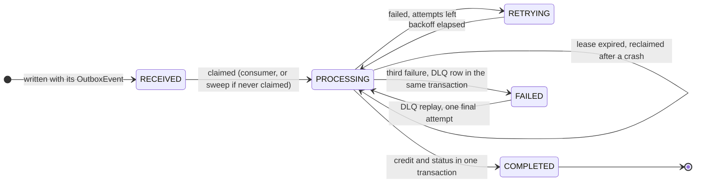
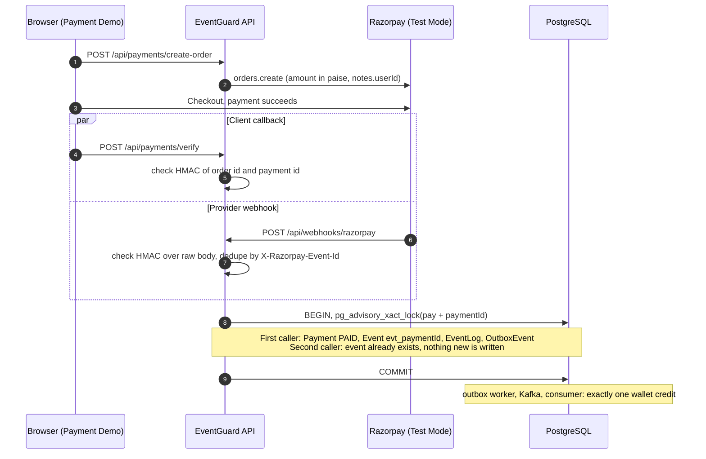

<div align="center">

# EventGuard

**Exactly-once business effects on top of at-least-once delivery.**

An event-driven payment pipeline built on Kafka, PostgreSQL, Redis and Razorpay (Test Mode).<br>
Deliver the same payment event once or fifty times, and the wallet is still credited exactly once.


</div>

<p align="center">
  
</p>

> [!NOTE]
> EventGuard does **not** claim Kafka-level exactly-once delivery. Kafka stays an at-least-once transport. What EventGuard guarantees is an exactly-once **business effect**: one wallet credit per logical payment, enforced in the application and database layers.

---

## Contents

- [The problem](#the-problem)
- [How EventGuard solves it](#how-eventguard-solves-it)
- [Architecture](#architecture)
- [The seven idempotency guards](#the-seven-idempotency-guards)
- [Event lifecycle](#event-lifecycle)
- [Payment flow: verify vs. webhook race](#payment-flow-verify-vs-webhook-race)
- [Failure handling](#failure-handling)
- [Security model](#security-model)
- [Tech stack](#tech-stack)
- [Getting started](#getting-started)
- [Configuration](#configuration)
- [API reference](#api-reference)
- [Local development](#local-development)
- [Testing](#testing)
- [Observability](#observability)
- [Performance](#performance)
- [Project structure](#project-structure)
- [Limitations](#limitations)
- [Author and license](#author-and-license)

---

## The problem

In a distributed system, the same event routinely arrives more than once:

- a Kafka consumer crashes after doing the work but before committing its offset, so the message is redelivered
- Razorpay retries a webhook it believes failed
- a client times out and retries
- the browser's `verify` callback and the provider's webhook race each other for the same payment

A naive consumer turns each of those into money:

```text
₹100 payment succeeds  →  event delivered twice  →  wallet credited twice  →  balance off by ₹100
```

EventGuard's contract is:

```text
deliveries observed: N (N ≥ 1)   →   wallet credits: 1   →   balance change: ₹100
```

## How EventGuard solves it

Instead of trusting the transport, EventGuard layers several independent controls so that any one duplicate path is stopped by at least one durable guard:

1. **Transactional outbox.** `Event`, `EventLog` and `OutboxEvent` are written in one PostgreSQL transaction. An event can never exist without its outbox row, and nothing is published before the commit.
2. **Canonical identity.** A Razorpay payment always maps to `evt_{razorpayPaymentId}`, whether it arrives through `verify` or the webhook.
3. **Coordination in Redis.** A completed-event cache and a `SET NX EX` lock cut down concurrent and repeated work. They are an optimisation, never the source of truth.
4. **Durable guards in PostgreSQL.** An atomic claim with a lease and a fencing token, an advisory lock, `UNIQUE` and `CHECK` constraints make the final decision. The wallet credit and the `COMPLETED` status commit in **one** transaction, ending at `WalletTransaction.eventId UNIQUE`.
5. **Explicit failure semantics.** Business failures go through exponential-backoff retries and a dead-letter table with replay. Infrastructure failures (Redis down or hung, PostgreSQL unreachable) rethrow, so the Kafka offset is not committed and the message is redelivered.
6. **Recovery from the database.** A sweeper finishes anything delivery missed: events whose worker crashed mid-claim, and events that were published but never claimed. Kafka is the fast path; PostgreSQL decides what is still owed.
7. **Evidence.** Concurrency, failure-injection and load tests run against real PostgreSQL, Redis and Kafka, locally and in CI. Metrics, structured logs and a reconciliation job make the guarantees observable in production.

The reasoning behind each mechanism is recorded in the [architecture decision records](docs/adr/README.md).

## Architecture

The diagram at the top of this page is the full system. The Compose stack runs six containers: `postgres`, `redis`, `zookeeper`, `kafka`, `backend` and `frontend`. The `backend` container runs **two processes** side by side ([`backend/start.sh`](backend/start.sh)):

| Process | Entry point | Responsibilities |
|---|---|---|
| API | [`src/server.ts`](backend/src/server.ts) | Express HTTP API, Kafka producer, **outbox worker**, **retry/recovery worker**, **reconciliation job**, `/metrics` |
| Consumer | [`src/eventConsumer.ts`](backend/src/eventConsumer.ts) | Kafka consumer (group `eventguard-workers`) running `processEvent()`, `/metrics` and `/health` on `:9464` |

On container start, `start.sh` runs `prisma migrate deploy` and then launches both processes. If either one exits, it stops the other, so the container fails as a unit.

**The happy path, end to end:**

1. A client calls the API: `POST /api/events`, `POST /api/payments/verify`, or Razorpay calls `POST /api/webhooks/razorpay`.
2. The API writes `Event (RECEIVED)` + `EventLog` + `OutboxEvent (PENDING)` in a single transaction.
3. The **outbox worker** leases up to 50 `PENDING` rows (`FOR UPDATE SKIP LOCKED`, so API replicas never take the same rows), publishes them to `eventguard.events` (3 partitions, keyed by `eventId`) in one request, and marks them `PUBLISHED`. It polls every 500 ms, and immediately again after a full batch. A publish error keeps the rows `PENDING` with exponential backoff.
4. The **consumer** (all partitions in parallel, messages in concurrent chunks, offsets committed in order) runs `processEvent()`: completed-cache check → Redis lock → **atomic claim** in PostgreSQL (one conditional `UPDATE` that stamps a lease and a fencing token).
5. One transaction, fenced by that token, marks the event `COMPLETED`, writes the ledger row and increments the balance. A worker that lost its claim writes nothing, and a crash leaves all of it or none.

## The seven idempotency guards

The numbers match the amber badges in the diagram.

| # | Where | Mechanism | What it stops | Durable? |
|---|---|---|---|---|
| 1 | API ingress | `Event.eventId` UNIQUE; `Event` + `EventLog` + `OutboxEvent` in one transaction | Duplicate event creation (HTTP `409`); events without an outbox row | Yes |
| 2 | Payments | Canonical `evt_{razorpayPaymentId}`, `pg_advisory_xact_lock(hashtext('pay:' + id))`, `Payment.razorpayPaymentId` UNIQUE | The `verify` ↔ webhook race producing two events | Yes |
| 3 | Webhooks | HMAC-SHA256 over the **raw request bytes** (timing-safe compare); `WebhookEvent.razorpayEventId` UNIQUE, keyed by `X-Razorpay-Event-Id` | Forged or re-serialised payloads; provider redelivery | Yes |
| 4 | Consumer | Redis completed cache (24 h TTL) | Repeat deliveries of finished events, cheaply | No, optimisation only |
| 5 | Consumer | Redis lock `SET key NX EX 30`, released by an atomic compare-and-delete script | Two workers processing the same event concurrently | No, coordination only |
| 6 | Consumer | **Atomic claim**: one conditional `UPDATE` to `PROCESSING` with a lease and a fencing token; later writes require the token | Two workers both claiming; a stalled worker writing after another took over | Yes |
| 7 | Wallet | `WalletTransaction.eventId` UNIQUE, checked and written in the same fenced transaction that marks the event `COMPLETED` | The double credit itself. This is the last line of defence. | Yes |

Every duplicate the consumer catches (guards 4 to 7) is recorded in `event_logs` with status `DUPLICATE` and the reason, so you can see which guard stopped it.

> [!IMPORTANT]
> Redis errors are classified as infrastructure failures (`RedisLockError`), **not** as lock contention. If the lock cannot be acquired because Redis is down or not answering (commands time out after 2 s), the consumer rethrows, KafkaJS does not commit the offset, and the message is redelivered. Once Redis is back, the same running process completes the event; no restart is needed.

With Redis switched off entirely, PostgreSQL alone still yields one claim and one credit for 100 competing workers. That is a [tested](docs/TESTING.md) property, not an assumption.

## Event lifecycle



`attemptCount` is incremented on each claim. The default budget is 3 attempts (`Event.maxAttempts`). Every transition out of `PROCESSING` is conditional on the claim's fencing token.

## Payment flow: verify vs. webhook race

Both payment paths funnel into one function, `ensurePaymentSuccessEvent()` ([`paymentService.ts`](backend/src/services/paymentService.ts)), which serialises on a per-payment advisory lock:



A `payment.failed` webhook for a payment that is already `PAID` is ignored, so a late failure notice cannot undo a success.

## Failure handling

| Scenario | Behaviour |
|---|---|
| Business error during processing | Event → `RETRYING` with `nextRetryAt`; backoff is `1 s × 2^(attempt − 1)`, capped at 30 s. A Kafka copy arriving during the backoff is a duplicate. |
| Retry is due | The **retry worker** (API process, 2 s poll) re-runs `processEvent()` in-process, with the same guards 4 to 7 |
| Third failure | Event → `FAILED` and a `DeadLetterEvent` row (`PENDING`) in **one** transaction. FAILED is terminal for retries and redeliveries. |
| `POST /api/dlq/:eventId/replay` | Atomically starts the replay (concurrent requests get 409), claims the event `FAILED` → `PROCESSING` for **one** attempt. Success completes it and resolves the DLQ row; failure returns it to the DLQ with the new reason. |
| Consumer crashes after claiming | The lease (`EVENT_LEASE_SECONDS`, 60) expires and the recovery sweep completes the event |
| Consumer crashes after the credit commits | The redelivered message finds the event `COMPLETED` and is recorded as a duplicate |
| Delivery meets a Redis lock left by a crashed worker | Treated as contention; the sweep runs events still `RECEIVED` after `STALE_RECEIVED_SECONDS` (120) |
| Redis down or hung | `RedisLockError` (2 s command timeout) is rethrown; the Kafka offset is not committed, so the message is redelivered |
| PostgreSQL unreachable | The claim fails; the offset is not committed; no money moves |
| Kafka unreachable | Outbox rows stay `PENDING` with exponential backoff (up to 60 s); the stale-`RECEIVED` sweep still credits payments from the database |
| Outbox publisher crashes mid-batch | Its lease expires; the rows are re-published; consumers absorb the duplicate |
| Webhook stored, then the API crashed | Razorpay's redelivery is processed (only `PROCESSED`/`IGNORED` deliveries count as duplicates) |
| Duplicate `POST /api/events` | HTTP `409 Event already exists` |

Each row is covered by an automated test against real infrastructure; see [docs/TESTING.md](docs/TESTING.md).

To exercise the retry path on purpose, set `FAIL_PROCESSING_FOR_EVENT_ID=<eventId>` on the backend. That event will fail every attempt and land in the DLQ.

## Security model

Every route except health, demo login, the public payment config and the HMAC-signed webhook requires a **JWT bearer token** (HS256). Tokens carry a subject (`sub` = user id) and a role, `user` or `admin`. The access policy is declared in one place, [`src/app.ts`](backend/src/app.ts):

| Caller | Can do |
|---|---|
| Anyone | `GET /health*`, `POST /api/auth/demo-login`, `GET /api/payments/config` |
| Razorpay (HMAC over raw body) | `POST /api/webhooks/razorpay` |
| `user` | Create and read **their own** wallet and ledger; create orders and verify payments **for themselves** |
| `admin` | Everything above for any user, plus events, manual retry, outbox, DLQ replay/resolve, webhook history |

What is enforced, and where:

- **Token checks** ([`lib/auth.ts`](backend/src/lib/auth.ts)): signature, algorithm pinned to HS256 (rejects `alg: none` and algorithm swaps), issuer, audience, expiry, and a known role.
- **Ownership** ([`middleware/auth.ts`](backend/src/middleware/auth.ts)): a user requesting `/api/wallets/<someone-else>` gets `403`. Bodies that name a different `userId` are refused rather than silently honoured.
- **Payment binding**: `POST /api/payments/verify` credits the **token's** user, and only if the Razorpay order was created for that user (`order.notes.userId`). A valid signature for someone else's order gets `403 ORDER_OWNERSHIP_MISMATCH`.
- **Request validation** ([`validation/schemas.ts`](backend/src/validation/schemas.ts), zod): ids are length-bounded and limited to a safe character set, unknown fields are rejected, `PAYMENT_SUCCESS` payloads are checked strictly (positive amount, at most 2 decimals, at most ₹1,000,000), and pagination is capped at 100 per page. Malformed JSON returns `400` and oversized bodies `413`, not `500`.
- **Secrets**: the checkout signature and the admin key are compared in constant time. At startup the backend requires a 32+ character `JWT_SECRET`, and in production it refuses publicly known placeholder secrets and refuses to run with demo login enabled.

**Getting a token.** There is no user store; `POST /api/auth/demo-login` stands in for an identity provider in local and demo setups. It issues a `user` token for any id, and an `admin` token only with the `ADMIN_API_KEY` shared secret. It is rate-limited to 10 requests/min per IP and is disabled by default when `NODE_ENV=production`.

## Tech stack

| Layer | Technology |
|---|---|
| Frontend | React 18, TypeScript, Vite 5, Tailwind CSS, Ant Design |
| Backend | Node.js 20, TypeScript, Express 4, `tsx` |
| ORM / DB | Prisma 5, PostgreSQL 16 |
| Cache and locks | Redis 7 via `ioredis` |
| Messaging | Apache Kafka (Confluent 7.5 images) + ZooKeeper, via `kafkajs` |
| Payments | Razorpay Node SDK, Test Mode only |
| Security | JWT (`jsonwebtoken`, HS256) with roles, `zod` request validation, `helmet`, CORS allow-list, per-route rate limits, startup config guards |
| Observability | `prom-client` metrics, structured JSON logs with request/event correlation, Prometheus + Grafana (optional profile) |
| Testing | Vitest + Supertest, Docker Compose test stack, k6 load tests, GitHub Actions |
| Runtime | Docker Compose |

## Getting started

### Prerequisites

- Docker Desktop (or Docker Engine + Compose v2)
- Optional: Node.js 20 and npm 9+ for running pieces on the host

### 1. Clone and configure

```bash
git clone https://github.com/shreyas0917/EventGuard.git
cd EventGuard
cp .env.example .env
```

Razorpay is optional. Either replace the three placeholders with **Test Mode** keys from the Razorpay dashboard, or set all three to empty to boot with payments disabled (`/api/payments/config` then reports `configured: false`):

```dotenv
RAZORPAY_KEY_ID=rzp_test_...
RAZORPAY_KEY_SECRET=...
RAZORPAY_WEBHOOK_SECRET=...
```

If any one of them is set, the backend requires all three at startup.

> [!WARNING]
> Never commit `.env`. It is git-ignored. Use Test Mode credentials only.

### 2. Start the stack

```bash
docker compose up -d --build
```

| Service | URL / port |
|---|---|
| Dashboard | http://localhost:5173 |
| API | http://localhost:3001 |
| PostgreSQL | `5433` with the example `.env` (`POSTGRES_PORT`, Compose default `5432`) |
| Redis | `6379` |
| Kafka | `9092` |
| ZooKeeper | `2181` |

### 3. Check health

```bash
curl http://localhost:3001/health         # liveness
curl http://localhost:3001/health/ready   # 200 only when PostgreSQL, Redis and Kafka are reachable
```

### 4. See idempotency in action

```bash
API=http://localhost:3001
login() { curl -s -X POST $API/api/auth/demo-login -H "Content-Type: application/json" -d "$1" \
  | node -pe "JSON.parse(require('fs').readFileSync(0)).token"; }

USER=$(login '{"userId":"user_1"}')
ADMIN=$(login '{"userId":"ops","role":"admin","adminKey":"dev-admin-key-change-me"}')

# the user creates their own wallet
curl -s -X POST $API/api/wallets -H "Authorization: Bearer $USER" \
  -H "Content-Type: application/json" -d '{}'

# an admin injects a payment event (only admins can create events)
curl -s -X POST $API/api/events -H "Authorization: Bearer $ADMIN" \
  -H "Content-Type: application/json" \
  -d '{"eventId":"evt_demo_1","eventType":"PAYMENT_SUCCESS",
       "payload":{"userId":"user_1","paymentId":"pay_demo_1","orderId":"order_demo_1","amount":100}}'

# send the exact same event again: 409 Event already exists
# (same command as above)

# one CREDIT of 100, no matter how many times you retried
curl -s $API/api/wallets/user_1/transactions -H "Authorization: Bearer $USER"
curl -s $API/api/events/evt_demo_1/history -H "Authorization: Bearer $ADMIN"

# and the user cannot look at anyone else's wallet: 403
curl -s $API/api/wallets/user_2 -H "Authorization: Bearer $USER"
```

`dev-admin-key-change-me` is the Compose development default for `ADMIN_API_KEY`. Set your own in `.env`. [`scripts/smoke-auth.sh`](scripts/smoke-auth.sh) runs this whole flow, plus the denial cases, as a pass/fail check.

Or open the dashboard at http://localhost:5173 and sign in with the panel at the top right: a user id for the Payment Demo tab, and the admin key for the event tabs.

| Tab | What it shows |
|---|---|
| Event Processing | Create `PAYMENT_SUCCESS` events; watch events and outbox rows change status |
| Idempotency Demo | Fire duplicate deliveries and see a single credit |
| Payment Demo | Razorpay Test Mode checkout → verify → wallet update |

To test real Razorpay webhooks locally, expose port `3001` through a tunnel (ngrok, Cloudflare Tunnel) and point a Test Mode webhook at `https://<tunnel>/api/webhooks/razorpay`.

## Configuration

All variables are listed in [`.env.example`](.env.example). The backend validates required variables at startup and refuses to boot without them.

| Group | Variables |
|---|---|
| Database | `DATABASE_URL`, `POSTGRES_USER`, `POSTGRES_PASSWORD`, `POSTGRES_DB`, `POSTGRES_PORT` |
| Redis | `REDIS_HOST`, `REDIS_PORT`, `REDIS_DB` |
| Kafka | `KAFKA_BROKERS`, `KAFKA_TOPIC`, `KAFKA_CONSUMER_GROUP` |
| API | `BACKEND_PORT`, `NODE_ENV`, `CORS_ORIGIN` |
| Frontend | `FRONTEND_PORT`, `VITE_API_URL` |
| Razorpay | `RAZORPAY_KEY_ID`, `RAZORPAY_KEY_SECRET`, `RAZORPAY_WEBHOOK_SECRET`, `RAZORPAY_TEST_MODE` |
| Rate limits | `RATE_LIMIT_WINDOW_MS` (60000), `RATE_LIMIT_MAX_REQUESTS` (100 per IP), `WEBHOOK_RATE_LIMIT_MAX_REQUESTS` (600 per sender IP) |
| Auth | `JWT_SECRET` (required, 32+ chars), `JWT_TTL_SECONDS` (3600), `AUTH_DEMO_LOGIN` (`true` outside production), `ADMIN_API_KEY` (16+ chars), `JWT_ISSUER`, `JWT_AUDIENCE` |
| Observability | `SERVICE_NAME`, `LOG_FORMAT` (`json`, or `pretty`), `LOG_LEVEL`, `METRICS_TOKEN` (optional bearer for `/metrics`), `CONSUMER_METRICS_PORT` (9464) |

Tuning knobs, with their defaults:

| Variable | Default | Effect |
|---|---|---|
| `OUTBOX_POLL_INTERVAL_MS` / `OUTBOX_BATCH_SIZE` | `500` / `50` | Outbox worker cadence; a full batch triggers the next cycle at once |
| `OUTBOX_LEASE_SECONDS` | `30` | How long a claimed outbox batch is reserved for one publisher |
| `RETRY_POLL_INTERVAL_MS` | `2000` | Retry/recovery worker cadence |
| `RETRY_BASE_DELAY_MS` / `MAX_RETRY_DELAY_MS` | `1000` / `30000` | Exponential backoff bounds |
| `EVENT_LEASE_SECONDS` | `60` | How long a processing claim is honoured before another worker may take over |
| `STALE_RECEIVED_SECONDS` | `120` | Age after which a never-claimed event is run by the recovery sweep |
| `REDIS_LOCK_TTL_SECONDS` | `30` | Processing lock TTL |
| `REDIS_COMMAND_TIMEOUT_MS` | `2000` | A hung Redis fails commands after this long instead of stalling |
| `REDIS_COMPLETED_TTL_SECONDS` | `86400` | Completed-cache TTL |
| `KAFKA_FROM_BEGINNING` | `true` | Where a consumer group without a committed offset starts (ADR 0005) |
| `KAFKA_SESSION_TIMEOUT_MS` | `30000` | How long before the group coordinator declares a silent consumer dead |
| `KAFKA_PARTITIONS_CONCURRENCY` / `KAFKA_PROCESSING_CONCURRENCY` | `3` / `10` | Partitions consumed in parallel / messages processed concurrently per partition batch (offsets still commit in order) |
| `RECONCILIATION_INTERVAL_MS` | `300000` | Read-only ledger/balance cross-check; `0` disables it |
| `PROCESSING_DELAY_MS` | `0` | Artificial delay, useful for racing duplicates in demos |
| `FAIL_PROCESSING_FOR_EVENT_ID` / `FAULT_INJECTION` | unset | Test-only fault hooks; refused at startup in production |

## API reference

All `/api/*` routes are rate-limited. `/api/dlq` and `/api/auth` use a stricter limit; `/api/webhooks` has its own. The access level of each group is listed in [Security model](#security-model).

<details>
<summary><b>Auth</b></summary>

| Method | Path | Purpose |
|---|---|---|
| POST | `/api/auth/demo-login` | `{"userId"}` → user token; `{"userId","role":"admin","adminKey"}` → admin token |
| GET | `/api/auth/me` | Identity of the presented token |

</details>

<details>
<summary><b>Health</b></summary>

| Method | Path | Purpose |
|---|---|---|
| GET | `/health` | Liveness |
| GET | `/health/ready` | Readiness: PostgreSQL, Redis, Kafka (`503` if any is down) |
| GET | `/metrics` | Prometheus metrics for the API process (optional `METRICS_TOKEN`) |

</details>

<details>
<summary><b>Events and outbox</b></summary>

| Method | Path | Purpose |
|---|---|---|
| POST | `/api/events` | Create an event and its outbox row (`409` on duplicate `eventId`) |
| GET | `/api/events` | List events (paginated) |
| GET | `/api/events/:eventId` | Event details |
| GET | `/api/events/:eventId/history` | Event log history, including `DUPLICATE` entries |
| GET | `/api/events/failed` | Failed events |
| GET | `/api/events/retrying` | Events waiting for retry |
| POST | `/api/events/:eventId/retry` | Schedule a manual retry |
| GET | `/api/outbox` | Outbox rows |
| GET | `/api/outbox/:eventId` | Outbox row for one event |

</details>

<details>
<summary><b>Wallets</b></summary>

| Method | Path | Purpose |
|---|---|---|
| POST | `/api/wallets` | Create a wallet (`{"userId": "..."}`) |
| GET | `/api/wallets/:userId` | Wallet and balance |
| GET | `/api/wallets/:userId/transactions` | Ledger entries |

</details>

<details>
<summary><b>Payments and webhooks (Razorpay Test Mode)</b></summary>

| Method | Path | Purpose |
|---|---|---|
| GET | `/api/payments/config` | Public config: `configured` flag and `keyId` only |
| POST | `/api/payments/create-order` | Create a Razorpay order (amount in INR, converted to paise) |
| POST | `/api/payments/verify` | Verify the checkout signature and ensure the canonical event |
| POST | `/api/webhooks/razorpay` | Webhook ingress (raw-body HMAC) |
| GET | `/api/webhooks/razorpay` | Stored webhook deliveries |
| GET | `/api/webhooks/razorpay/:id` | One webhook delivery |

</details>

<details>
<summary><b>Dead-letter queue</b></summary>

| Method | Path | Purpose |
|---|---|---|
| GET | `/api/dlq` | List DLQ entries (filter by status) |
| GET | `/api/dlq/:eventId` | DLQ entry details |
| POST | `/api/dlq/:eventId/replay` | One immediate, fenced attempt at a failed event (`409` if a replay is already running) |
| POST | `/api/dlq/:eventId/resolve` | Mark resolved manually |
| GET | `/api/dlq/stats/summary` | Counts by status |

</details>

<details>
<summary><b>Admin</b></summary>

| Method | Path | Purpose |
|---|---|---|
| GET | `/api/admin/reconciliation` | Read-only cross-check of balances, ledger, events and outbox |

</details>

## Local development

**Everything in Docker (recommended):**

```bash
npm run docker:up      # docker compose up -d
npm run docker:logs    # follow logs
npm run docker:down
```

The Compose file bind-mounts `backend/src` and `frontend/src`. The API process and the Vite dev server reload on change; the consumer process picks up changes on `docker compose restart backend`.

**Backend on the host, infrastructure in Docker:**

```bash
docker compose up -d postgres redis zookeeper kafka
cd backend
cp ../.env .env           # the backend reads .env from its own directory
npm install
npx prisma generate
npx prisma migrate deploy
npm run dev               # API + outbox worker + retry worker
npm run worker:events     # Kafka consumer, in a second terminal
```

**Frontend on the host:**

```bash
cd frontend
npm install
npm run dev               # Vite proxies /api to BACKEND_URL (default http://localhost:3001)
```

| Command | Where | Purpose |
|---|---|---|
| `npm run build` | root | Compile the backend and build the frontend |
| `npm run lint` | root | ESLint across both workspaces |
| `npm run worker:outbox` | `backend/` | Run the outbox worker as a standalone process |
| `npm run worker:events` | `backend/` | Run the Kafka consumer |

## Testing

Three automated suites back the guarantees. All of them run in CI ([`.github/workflows/ci.yml`](.github/workflows/ci.yml)).

| Suite | Tests | Runs against | Command (in `backend/`) |
|---|---|---|---|
| Security | 130 | in-process (Prisma and Razorpay replaced by in-memory doubles) | `npm run test:security` |
| Concurrency | 20 | disposable PostgreSQL, Redis and Kafka | `npm run test:integration` |
| Failure injection | 19 | the same disposable stack, with containers paused, stopped and processes killed | `npm run test:integration` |

```bash
npm run test:infra:up                      # repo root: start the disposable test stack
cd backend && npm run test:security && npm run test:integration
```

The integration suites never touch the development database. They use a separate Compose project ([`docker-compose.test.yml`](docker-compose.test.yml)) on its own ports with no named volumes, and refuse to run against a database whose name does not end in `_test`.

What they demonstrate (details in [docs/TESTING.md](docs/TESTING.md)):

- **100 simultaneous deliveries** of one payment → exactly one credit, `attemptCount = 1`, 99 recorded duplicates. Also with the Redis lock and cache switched off.
- **100 simultaneous signed webhook deliveries**, and verify racing webhooks for one payment → one payment, one event, one credit.
- **Two independent Kafka consumer groups** each receiving 100 copies of one event → one credit.
- **Consumer process killed** (exit 137) right after the credit commits, or right after claiming → exactly one credit after restart and recovery.
- **Redis stopped or hung, PostgreSQL hung, Kafka stopped** → no money moves during the outage, exactly one credit after it.
- **Retry exhaustion** → FAILED and dead-lettered atomically; a replay after the fix credits once.
- A stale worker writes nothing; concurrent outbox publishers claim disjoint rows; CHECK constraints reject impossible ledger rows; reconciliation flags writes that bypassed the application.

Every money test also checks two global invariants: every wallet's balance equals its ledger sum, and no completed payment has other than exactly one ledger row.

**End-to-end smoke test** against the running dev stack (`docker compose up`): `bash scripts/smoke-auth.sh` exercises auth, ownership and one-credit processing through the real Kafka pipeline.

<details>
<summary><b>Legacy scenario scripts</b></summary>

These predate the Vitest suites and run with `tsx` against a running stack. They are kept for reference and are not run in CI.

| Command | Covers |
|---|---|
| `npm test` | Event create / read / history round trip |
| `npm run test:phase3` / `test:phase4` / `test:phase5` | Outbox atomicity, producer publish, consumer idempotency |
| `npx tsx tests/phase7.test.ts` | Retry engine, backoff and DLQ |
| `npx tsx tests/phase9.test.ts` | Webhook signature acceptance and rejection |
| `docker exec eventguard-backend npx tsx scripts/f3_payment_idempotency_test.ts` | `verify` + webhook convergence |
| `docker exec eventguard-backend npx tsx scripts/f4_raw_body_webhook_test.ts` | HMAC over the original request bytes |

</details>

## Observability

| Signal | Where |
|---|---|
| **Metrics** | `GET /metrics` on the API (`:3001`) and on the consumer process (`:9464`), Prometheus format |
| **Dashboards and alerts** | `docker compose --profile observability up -d` adds Prometheus (`:9090`) with [alert rules](observability/alerts.yml), and Grafana (`:3000`) with a provisioned dashboard |
| **Logs** | One JSON object per line. HTTP lines carry `requestId` (echoed as `X-Request-ID`) and the route pattern; pipeline lines carry `eventId`, plus `partition`/`offset` or `trigger: "retry-worker"` |
| **Ledger consistency** | Read-only reconciliation every 5 min, and on demand at `GET /api/admin/reconciliation` |

Key metrics: event outcomes and processing latency (`eventguard_events_processed_total`, `eventguard_event_processing_duration_seconds`), end-to-end latency from API commit to credit commit (`eventguard_event_end_to_end_seconds`), duplicates by the guard that stopped them (`eventguard_duplicate_deliveries_total{reason}`), retries, dead-letters, Redis lock errors, outbox backlog and oldest pending age, consumer lag, open DLQ entries, wallet credits, webhook and verification results, HTTP latency by route, and reconciliation findings.

[docs/RUNBOOK.md](docs/RUNBOOK.md) maps each alert to the steps that diagnose it.

## Performance

Measured on one laptop running the whole stack, so these are **lower bounds** with full conditions in [docs/PERFORMANCE.md](docs/PERFORMANCE.md):

| Load | Processing throughput | End-to-end latency p50 / p95 / p99 | Money invariants |
|---|---|---|---|
| 20 events/s (below capacity) | keeps up | **357 / 663 / 1,158 ms** | hold |
| 100 events/s, concurrent consumer | **65.7 events/s** | queueing above capacity | hold, 6,002 credits for 6,002 events |
| 100 events/s, serial consumer | 12.0 events/s | queueing above capacity | hold |

HTTP ingest took 100 requests/s with 0 errors. Every client retry (10% of requests) was refused with `409`, and a 100-way simultaneous storm on one `eventId` created and credited exactly one event. Reproduce with [`scripts/perf/run-loadtest.sh`](scripts/perf/run-loadtest.sh) (k6 in Docker, against the disposable stack).

## Project structure

```text
EventGuard/
├── backend/
│   ├── prisma/
│   │   ├── schema.prisma          # events, outbox, wallets, ledger, payments, webhooks, DLQ
│   │   └── migrations/            # incl. claim lease, outbox lease, CHECK constraints
│   ├── src/
│   │   ├── server.ts              # API process: Express, outbox worker, retry/recovery worker, reconciliation
│   │   ├── eventConsumer.ts       # Consumer process (+ /metrics and /health)
│   │   ├── app.ts                 # middleware chain and the access policy
│   │   ├── kafka/                 # producer, concurrent consumer, processEvent() worker
│   │   ├── services/              # claims, fenced completion, wallet, payments, webhooks, DLQ, outbox, reconciliation
│   │   ├── workers/               # outbox, retry/recovery, reconciliation
│   │   ├── middleware/            # auth, validation, rate limits, correlation IDs, errors
│   │   ├── validation/            # zod request schemas
│   │   └── lib/                   # Prisma, Redis, Kafka, Razorpay clients, JWT, logger, metrics
│   ├── tests/
│   │   ├── security/              # in-process access-control, token and validation tests
│   │   ├── concurrency/           # duplicate and concurrent delivery against real infrastructure
│   │   └── failure/               # crashes and outages against real infrastructure
│   ├── scripts/loadtest-report.ts # end-to-end load-test measurements from the database
│   └── start.sh                   # migrate deploy, then API + consumer
├── frontend/                      # React dashboard with user/admin sign-in
├── observability/                 # Prometheus config, alert rules, Grafana provisioning + dashboard
├── loadtest/ingest.js             # k6 scenarios
├── docs/                          # architecture diagram, ADRs, runbook, testing, performance
├── scripts/                       # smoke test, load-test runner
├── docker-compose.yml             # dev stack (+ observability profile)
├── docker-compose.test.yml        # disposable stack for integration, failure and load tests
└── .github/workflows/ci.yml
```

## Limitations

This is an engineering demonstration of reliability patterns, not a production payment platform.

- Kafka consumption is at-least-once; exactly-once applies to business effects, enforced in PostgreSQL, not to delivery.
- Local Compose runs a single Kafka broker with replication factor 1, and performance figures come from one laptop.
- No Kubernetes manifests, distributed tracing (logs correlate by `requestId` and `eventId` instead) or multi-region setup.
- Demo login stands in for an identity provider: there is no user store, password or refresh-token flow, and tokens cannot be revoked before they expire.
- Rate limiting is in-memory per process, so it is not shared across replicas.
- The Razorpay checkout and webhook paths are tested with a faked Razorpay API; load tests drive the event-ingest path.
- Reconciliation reports discrepancies; correcting money is left to an operator.
- The frontend is a developer dashboard, not a product UI.

## Author and license

Built by **Shreyas Wani** ([@shreyas0917](https://github.com/shreyas0917)).

Licensed under ISC, as declared in [`backend/package.json`](backend/package.json).
