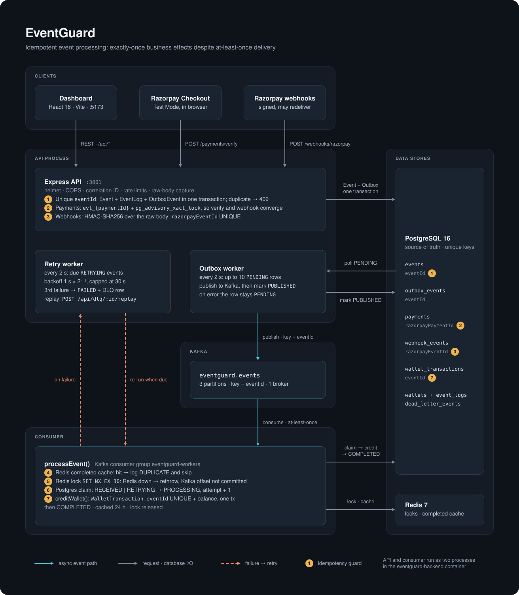
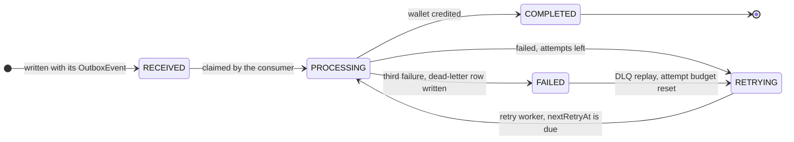
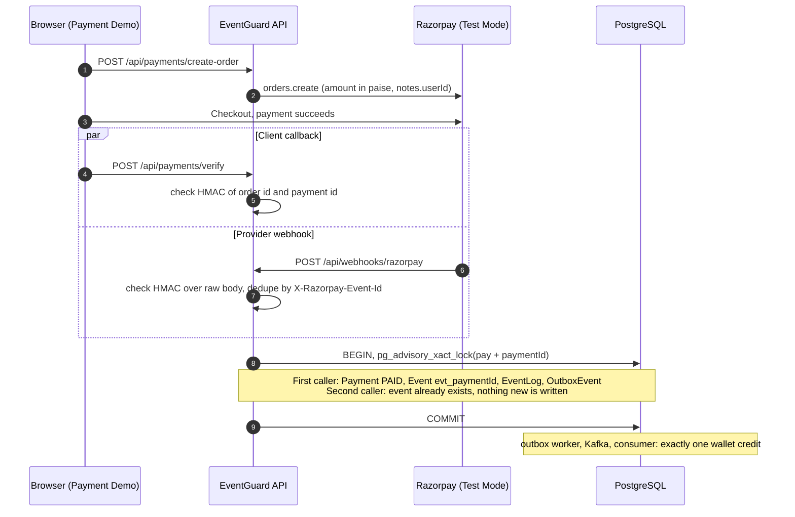

<div align="center">

# EventGuard

**Exactly-once business effects on top of at-least-once delivery.**

An event-driven payment pipeline built on Kafka, PostgreSQL, Redis and Razorpay (Test Mode).<br>
Deliver the same payment event once or fifty times, and the wallet is still credited exactly once.


</div>

<p align="center">
  
</p>

> [!NOTE]
> EventGuard does **not** claim Kafka-level exactly-once delivery. Kafka stays an at-least-once transport. What EventGuard guarantees is an exactly-once **business effect**: one wallet credit per logical payment, enforced in the application and database layers.

---

## Contents

- [The problem](#the-problem)
- [How EventGuard solves it](#how-eventguard-solves-it)
- [Architecture](#architecture)
- [The seven idempotency guards](#the-seven-idempotency-guards)
- [Event lifecycle](#event-lifecycle)
- [Payment flow: verify vs. webhook race](#payment-flow-verify-vs-webhook-race)
- [Failure handling](#failure-handling)
- [Tech stack](#tech-stack)
- [Getting started](#getting-started)
- [Configuration](#configuration)
- [API reference](#api-reference)
- [Local development](#local-development)
- [Testing and validation](#testing-and-validation)
- [Project structure](#project-structure)
- [Limitations](#limitations)
- [Author and license](#author-and-license)

---

## The problem

In a distributed system, the same event routinely arrives more than once:

- a Kafka consumer crashes after doing the work but before committing its offset, so the message is redelivered
- Razorpay retries a webhook it believes failed
- a client times out and retries
- the browser's `verify` callback and the provider's webhook race each other for the same payment

A naive consumer turns each of those into money:

```text
₹100 payment succeeds  →  event delivered twice  →  wallet credited twice  →  balance off by ₹100
```

EventGuard's contract is:

```text
deliveries observed: N (N ≥ 1)   →   wallet credits: 1   →   balance change: ₹100
```

## How EventGuard solves it

Instead of trusting the transport, EventGuard layers several independent controls so that any one duplicate path is stopped by at least one durable guard:

1. **Transactional outbox.** `Event`, `EventLog` and `OutboxEvent` are written in one PostgreSQL transaction. An event can never exist without its outbox row, and nothing is published before the commit.
2. **Canonical identity.** A Razorpay payment always maps to `evt_{razorpayPaymentId}`, whether it arrives through `verify` or the webhook.
3. **Coordination in Redis.** A completed-event cache and an `SET NX EX` lock cut down concurrent and repeated work. They are an optimisation, never the source of truth.
4. **Durable guards in PostgreSQL.** A status claim, an advisory lock and `UNIQUE` constraints make the final decision, ending at `WalletTransaction.eventId UNIQUE`.
5. **Explicit failure semantics.** Business failures go through exponential-backoff retries and a dead-letter table with replay. Infrastructure failures (Redis down) rethrow, so the Kafka offset is not committed and the message is redelivered.

## Architecture

The diagram at the top of this page is the full system. The Compose stack runs six containers: `postgres`, `redis`, `zookeeper`, `kafka`, `backend` and `frontend`. The `backend` container runs **two processes** side by side ([`backend/start.sh`](backend/start.sh)):

| Process | Entry point | Responsibilities |
|---|---|---|
| API | [`src/server.ts`](backend/src/server.ts) | Express HTTP API, Kafka producer, **outbox worker**, **retry worker** |
| Consumer | [`src/eventConsumer.ts`](backend/src/eventConsumer.ts) | Kafka consumer (group `eventguard-workers`) running `processEvent()` |

On container start, `start.sh` runs `prisma migrate deploy` and then launches both processes. If either one exits, it stops the other, so the container fails as a unit.

**The happy path, end to end:**

1. A client calls the API: `POST /api/events`, `POST /api/payments/verify`, or Razorpay calls `POST /api/webhooks/razorpay`.
2. The API writes `Event (RECEIVED)` + `EventLog` + `OutboxEvent (PENDING)` in a single transaction.
3. Every 2 s the **outbox worker** reads up to 10 `PENDING` rows, publishes each to the `eventguard.events` topic (3 partitions, keyed by `eventId`), and marks it `PUBLISHED`. A publish error leaves the row `PENDING` for the next poll.
4. The **consumer** receives the message and runs `processEvent()`: completed-cache check → Redis lock → PostgreSQL claim → `creditWallet()` → `COMPLETED`.
5. The wallet credit and the balance increment happen in one transaction, guarded by `WalletTransaction.eventId UNIQUE`.

## The seven idempotency guards

The numbers match the amber badges in the diagram.

| # | Where | Mechanism | What it stops | Durable? |
|---|---|---|---|---|
| 1 | API ingress | `Event.eventId` UNIQUE; `Event` + `EventLog` + `OutboxEvent` in one transaction | Duplicate event creation (HTTP `409`); events without an outbox row | Yes |
| 2 | Payments | Canonical `evt_{razorpayPaymentId}`, `pg_advisory_xact_lock(hashtext('pay:' + id))`, `Payment.razorpayPaymentId` UNIQUE | The `verify` ↔ webhook race producing two events | Yes |
| 3 | Webhooks | HMAC-SHA256 over the **raw request bytes** (timing-safe compare); `WebhookEvent.razorpayEventId` UNIQUE, keyed by `X-Razorpay-Event-Id` | Forged or re-serialised payloads; provider redelivery | Yes |
| 4 | Consumer | Redis completed cache (24 h TTL) | Repeat deliveries of finished events, cheaply | No, optimisation only |
| 5 | Consumer | Redis lock `SET key NX EX 30` | Two workers processing the same event concurrently | No, coordination only |
| 6 | Consumer | PostgreSQL claim: `RECEIVED` / `RETRYING` → `PROCESSING` | Reprocessing events that are completed, in flight or permanently failed | Yes |
| 7 | Wallet | `WalletTransaction.eventId` UNIQUE, written in the same transaction as the balance increment | The double credit itself. This is the last line of defence. | Yes |

Every duplicate the consumer catches (guards 4 to 7) is recorded in `event_logs` with status `DUPLICATE` and the reason, so you can see which guard stopped it.

> [!IMPORTANT]
> Redis errors are classified as infrastructure failures (`RedisLockError`), **not** as lock contention. If the lock cannot be acquired because Redis is down, the consumer rethrows, KafkaJS does not commit the offset, and the message is redelivered. Once Redis is back, the same running process completes the event; no restart is needed.

## Event lifecycle



`attemptCount` is incremented on each claim. The default budget is 3 attempts (`Event.maxAttempts`).

## Payment flow: verify vs. webhook race

Both payment paths funnel into one function, `ensurePaymentSuccessEvent()` ([`paymentService.ts`](backend/src/services/paymentService.ts)), which serialises on a per-payment advisory lock:



A `payment.failed` webhook for a payment that is already `PAID` is ignored, so a late failure notice cannot undo a success.

## Failure handling

| Scenario | Behaviour |
|---|---|
| Business error during processing | Event → `RETRYING` with `nextRetryAt`; backoff is `1 s × 2^(attempt − 1)`, capped at 30 s |
| Retry is due | The **retry worker** (API process, 2 s poll) re-runs `processEvent()` in-process, with the same guards 4 to 7 |
| Third failure | Event → `FAILED`; a `DeadLetterEvent` row is created with status `PENDING` |
| `POST /api/dlq/:eventId/replay` | Event reopened `FAILED` → `RETRYING` with a fresh attempt budget, then reprocessed; on success the DLQ row → `RESOLVED` |
| Redis unavailable while consuming | `RedisLockError` is rethrown; the Kafka offset is not committed, so the message is redelivered |
| Outbox publish fails | Row stays `PENDING`, `attemptCount` and `lastError` are updated, and the next poll retries it |
| Duplicate `POST /api/events` | HTTP `409 Event already exists` |

To exercise the retry path on purpose, set `FAIL_PROCESSING_FOR_EVENT_ID=<eventId>` on the backend. That event will fail every attempt and land in the DLQ.

## Tech stack

| Layer | Technology |
|---|---|
| Frontend | React 18, TypeScript, Vite 5, Tailwind CSS, Ant Design |
| Backend | Node.js 20, TypeScript, Express 4, `tsx` |
| ORM / DB | Prisma 5, PostgreSQL 16 |
| Cache and locks | Redis 7 via `ioredis` |
| Messaging | Apache Kafka (Confluent 7.5 images) + ZooKeeper, via `kafkajs` |
| Payments | Razorpay Node SDK, Test Mode only |
| Hardening | `helmet`, CORS allow-list, correlation IDs, per-route rate limits, env validation, graceful shutdown |
| Runtime | Docker Compose |

## Getting started

### Prerequisites

- Docker Desktop (or Docker Engine + Compose v2)
- Optional: Node.js 20 and npm 9+ for running pieces on the host

### 1. Clone and configure

```bash
git clone https://github.com/shreyas0917/EventGuard.git
cd EventGuard
cp .env.example .env
```

Razorpay is optional. Either replace the three placeholders with **Test Mode** keys from the Razorpay dashboard, or set all three to empty to boot with payments disabled (`/api/payments/config` then reports `configured: false`):

```dotenv
RAZORPAY_KEY_ID=rzp_test_...
RAZORPAY_KEY_SECRET=...
RAZORPAY_WEBHOOK_SECRET=...
```

If any one of them is set, the backend requires all three at startup.

> [!WARNING]
> Never commit `.env`. It is git-ignored. Use Test Mode credentials only.

### 2. Start the stack

```bash
docker compose up -d --build
```

| Service | URL / port |
|---|---|
| Dashboard | http://localhost:5173 |
| API | http://localhost:3001 |
| PostgreSQL | `5433` with the example `.env` (`POSTGRES_PORT`, Compose default `5432`) |
| Redis | `6379` |
| Kafka | `9092` |
| ZooKeeper | `2181` |

### 3. Check health

```bash
curl http://localhost:3001/health         # liveness
curl http://localhost:3001/health/ready   # 200 only when PostgreSQL, Redis and Kafka are reachable
```

### 4. See idempotency in action

```bash
# create a wallet
curl -s -X POST http://localhost:3001/api/wallets \
  -H "Content-Type: application/json" -d '{"userId":"user_1"}'

# send a payment event
curl -s -X POST http://localhost:3001/api/events \
  -H "Content-Type: application/json" \
  -d '{"eventId":"evt_demo_1","eventType":"PAYMENT_SUCCESS",
       "payload":{"userId":"user_1","paymentId":"pay_demo_1","orderId":"order_demo_1","amount":100}}'

# send the exact same event again: 409 Event already exists
# (same command as above)

# one CREDIT of 100, no matter how many times you retried
curl -s http://localhost:3001/api/wallets/user_1/transactions
curl -s http://localhost:3001/api/events/evt_demo_1/history
```

Or open the dashboard at http://localhost:5173:

| Tab | What it shows |
|---|---|
| Event Processing | Create `PAYMENT_SUCCESS` events; watch events and outbox rows change status |
| Idempotency Demo | Fire duplicate deliveries and see a single credit |
| Payment Demo | Razorpay Test Mode checkout → verify → wallet update |

To test real Razorpay webhooks locally, expose port `3001` through a tunnel (ngrok, Cloudflare Tunnel) and point a Test Mode webhook at `https://<tunnel>/api/webhooks/razorpay`.

## Configuration

All variables are listed in [`.env.example`](.env.example). The backend validates required variables at startup and refuses to boot without them.

| Group | Variables |
|---|---|
| Database | `DATABASE_URL`, `POSTGRES_USER`, `POSTGRES_PASSWORD`, `POSTGRES_DB`, `POSTGRES_PORT` |
| Redis | `REDIS_HOST`, `REDIS_PORT` |
| Kafka | `KAFKA_BROKERS` |
| API | `BACKEND_PORT`, `NODE_ENV`, `CORS_ORIGIN` |
| Frontend | `FRONTEND_PORT`, `VITE_API_URL` |
| Razorpay | `RAZORPAY_KEY_ID`, `RAZORPAY_KEY_SECRET`, `RAZORPAY_WEBHOOK_SECRET`, `RAZORPAY_TEST_MODE` |
| Rate limits | `RATE_LIMIT_WINDOW_MS` (60000), `RATE_LIMIT_MAX_REQUESTS` (100) |

Tuning knobs, with their defaults:

| Variable | Default | Effect |
|---|---|---|
| `OUTBOX_POLL_INTERVAL_MS` / `OUTBOX_BATCH_SIZE` | `2000` / `10` | Outbox worker cadence |
| `RETRY_POLL_INTERVAL_MS` | `2000` | Retry worker cadence |
| `RETRY_BASE_DELAY_MS` / `MAX_RETRY_DELAY_MS` | `1000` / `30000` | Exponential backoff bounds |
| `REDIS_LOCK_TTL_SECONDS` | `30` | Processing lock TTL |
| `REDIS_COMPLETED_TTL_SECONDS` | `86400` | Completed-cache TTL |
| `PROCESSING_DELAY_MS` | `0` | Artificial delay, useful for racing duplicates in demos |
| `FAIL_PROCESSING_FOR_EVENT_ID` | unset | Forces one event to fail, for retry/DLQ demos |

## API reference

All `/api/*` routes are rate-limited. `/api/dlq` uses a stricter limit; `/api/webhooks` has its own.

<details>
<summary><b>Health</b></summary>

| Method | Path | Purpose |
|---|---|---|
| GET | `/health` | Liveness |
| GET | `/health/ready` | Readiness: PostgreSQL, Redis, Kafka (`503` if any is down) |

</details>

<details>
<summary><b>Events and outbox</b></summary>

| Method | Path | Purpose |
|---|---|---|
| POST | `/api/events` | Create an event and its outbox row (`409` on duplicate `eventId`) |
| GET | `/api/events` | List events (paginated) |
| GET | `/api/events/:eventId` | Event details |
| GET | `/api/events/:eventId/history` | Event log history, including `DUPLICATE` entries |
| GET | `/api/events/failed` | Failed events |
| GET | `/api/events/retrying` | Events waiting for retry |
| POST | `/api/events/:eventId/retry` | Schedule a manual retry |
| GET | `/api/outbox` | Outbox rows |
| GET | `/api/outbox/:eventId` | Outbox row for one event |

</details>

<details>
<summary><b>Wallets</b></summary>

| Method | Path | Purpose |
|---|---|---|
| POST | `/api/wallets` | Create a wallet (`{"userId": "..."}`) |
| GET | `/api/wallets/:userId` | Wallet and balance |
| GET | `/api/wallets/:userId/transactions` | Ledger entries |

</details>

<details>
<summary><b>Payments and webhooks (Razorpay Test Mode)</b></summary>

| Method | Path | Purpose |
|---|---|---|
| GET | `/api/payments/config` | Public config: `configured` flag and `keyId` only |
| POST | `/api/payments/create-order` | Create a Razorpay order (amount in INR, converted to paise) |
| POST | `/api/payments/verify` | Verify the checkout signature and ensure the canonical event |
| POST | `/api/webhooks/razorpay` | Webhook ingress (raw-body HMAC) |
| GET | `/api/webhooks/razorpay` | Stored webhook deliveries |
| GET | `/api/webhooks/razorpay/:id` | One webhook delivery |

</details>

<details>
<summary><b>Dead-letter queue</b></summary>

| Method | Path | Purpose |
|---|---|---|
| GET | `/api/dlq` | List DLQ entries (filter by status) |
| GET | `/api/dlq/:eventId` | DLQ entry details |
| POST | `/api/dlq/:eventId/replay` | Reopen and reprocess a failed event |
| POST | `/api/dlq/:eventId/resolve` | Mark resolved manually |
| GET | `/api/dlq/stats/summary` | Counts by status |

</details>

## Local development

**Everything in Docker (recommended):**

```bash
npm run docker:up      # docker compose up -d
npm run docker:logs    # follow logs
npm run docker:down
```

The Compose file bind-mounts `backend/src` and `frontend/src`. The API process and the Vite dev server reload on change; the consumer process picks up changes on `docker compose restart backend`.

**Backend on the host, infrastructure in Docker:**

```bash
docker compose up -d postgres redis zookeeper kafka
cd backend
cp ../.env .env           # the backend reads .env from its own directory
npm install
npx prisma generate
npx prisma migrate deploy
npm run dev               # API + outbox worker + retry worker
npm run worker:events     # Kafka consumer, in a second terminal
```

**Frontend on the host:**

```bash
cd frontend
npm install
npm run dev               # Vite proxies /api to BACKEND_URL (default http://localhost:3001)
```

| Command | Where | Purpose |
|---|---|---|
| `npm run build` | root | Compile the backend and build the frontend |
| `npm run lint` | root | ESLint across both workspaces |
| `npm run worker:outbox` | `backend/` | Run the outbox worker as a standalone process |
| `npm run worker:events` | `backend/` | Run the Kafka consumer |

## Testing and validation

The tests are scenario scripts run with `tsx` against a **running** stack. Start it with `docker compose up` first.

| Command | Covers |
|---|---|
| `npm test` (in `backend/`) | Event create / read / history round trip |
| `npm run test:phase3` | Transactional outbox: event + outbox row written atomically |
| `npm run test:phase4` | Kafka producer publish path |
| `npm run test:phase5` | Consumer idempotency: first delivery processes, repeats are no-ops |
| `npx tsx tests/phase7.test.ts` | Retry engine, backoff and DLQ |
| `npx tsx tests/phase9.test.ts` | Webhook signature acceptance and rejection |
| `docker exec eventguard-backend npx tsx scripts/f3_payment_idempotency_test.ts` | `verify` + webhook convergence on one event and one credit |
| `docker exec eventguard-backend npx tsx scripts/f4_raw_body_webhook_test.ts` | HMAC is computed over the original bytes, not `JSON.stringify(req.body)` |

Behaviours exercised against the local stack during development:

- Migration deploy and schema consistency
- `PAYMENT_SUCCESS` → exactly one wallet `CREDIT`
- `409` on duplicate event creation
- `verify` and webhook converging on one event and one credit
- Raw-body HMAC acceptance and rejection
- Retry with backoff, DLQ, and replay
- Redis lock contention vs. Redis outage, and recovery from an outage without restarting the backend
- Live Razorpay Test Mode checkout → public webhook tunnel → HMAC → pipeline → single credit

## Project structure

```text
EventGuard/
├── backend/
│   ├── prisma/
│   │   ├── schema.prisma          # Event, OutboxEvent, Wallet, WalletTransaction, Payment, WebhookEvent, DeadLetterEvent
│   │   └── migrations/
│   ├── src/
│   │   ├── server.ts              # API process: Express + outbox worker + retry worker
│   │   ├── eventConsumer.ts       # Consumer process
│   │   ├── app.ts                 # middleware chain and route mounting
│   │   ├── kafka/                 # producer, consumer, processEvent() worker, topic setup
│   │   ├── workers/               # outbox, retry, consumer lifecycle
│   │   ├── services/              # events, claims, wallet, payments, webhooks, DLQ, Redis lock/cache
│   │   ├── routes/ controllers/   # HTTP API
│   │   ├── middleware/            # security headers, CORS, correlation ID, rate limits, errors
│   │   ├── config/                # config defaults + env validation
│   │   └── lib/                   # Prisma, Redis, Kafka, Razorpay clients, logger, graceful shutdown
│   ├── tests/                     # scenario tests (tsx)
│   ├── scripts/                   # payment and webhook validation scripts
│   ├── start.sh                   # migrate deploy, then API + consumer
│   └── Dockerfile
├── frontend/
│   └── src/components/            # EventCreator, EventList, OutboxList, IdempotencyDemo, PaymentDemo
├── docs/
│   └── architecture.svg           # the diagram above
├── scripts/                       # stack-level verification scripts
├── docker-compose.yml
└── .env.example
```

## Limitations

This is an engineering demonstration of reliability patterns, not a production payment platform.

- Kafka consumption is at-least-once; there is no Kafka transactional / exactly-once configuration.
- The PostgreSQL claim is a status check followed by an update, not a compare-and-swap. Concurrency safety comes from the Redis lock plus the final `UNIQUE` constraint.
- Local Compose runs a single Kafka broker with replication factor 1.
- No Kubernetes manifests, metrics or tracing stack, or multi-region setup.
- Razorpay support is intended for Test Mode.
- Admin endpoints (DLQ, retry) are rate-limited but not authenticated.
- The frontend is a developer dashboard, not a product UI.

## Author and license

Built by **Shreyas Wani** ([@shreyas0917](https://github.com/shreyas0917)).

Licensed under ISC, as declared in [`backend/package.json`](backend/package.json).
